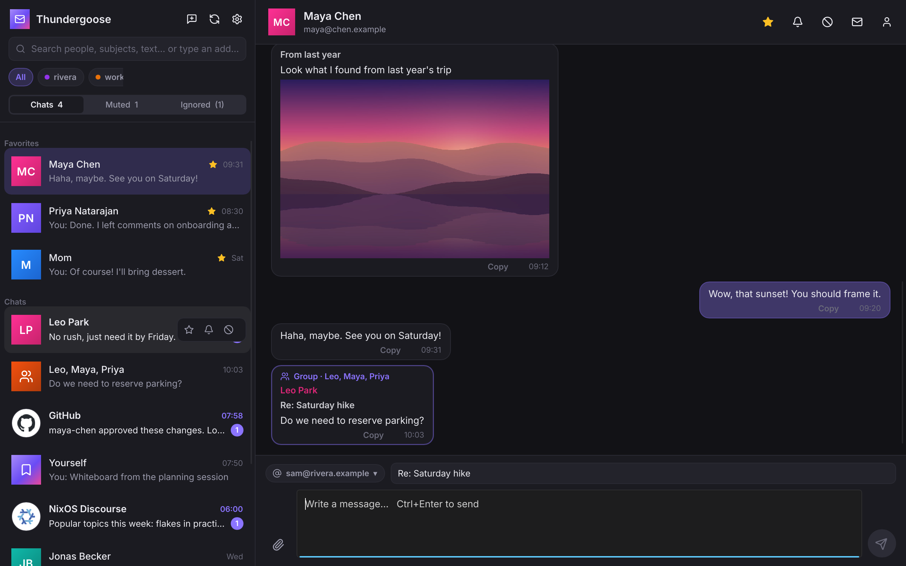
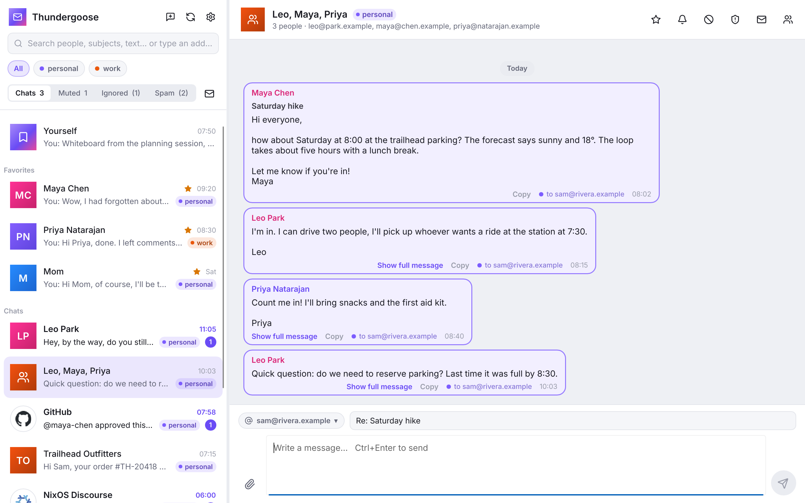
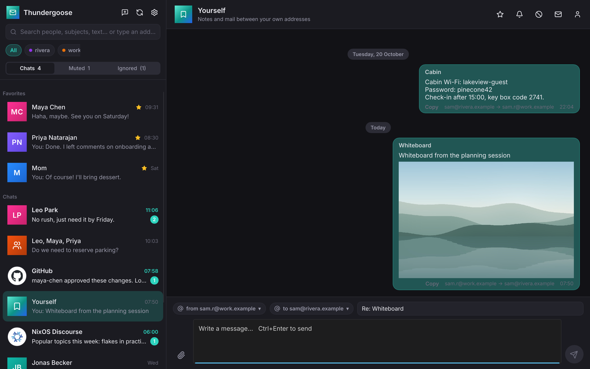
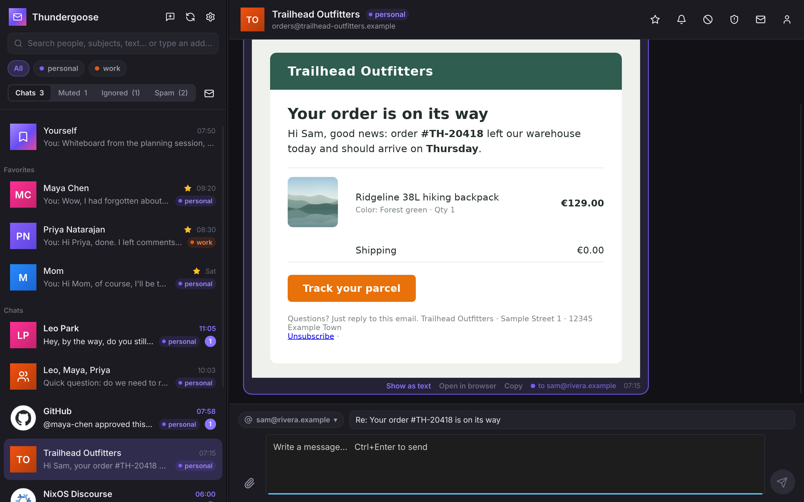
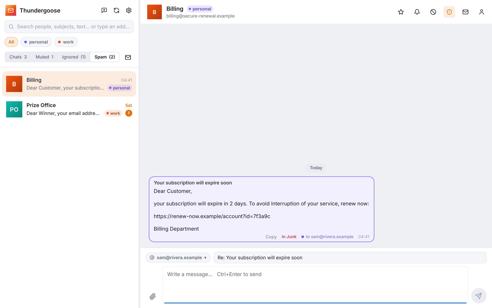
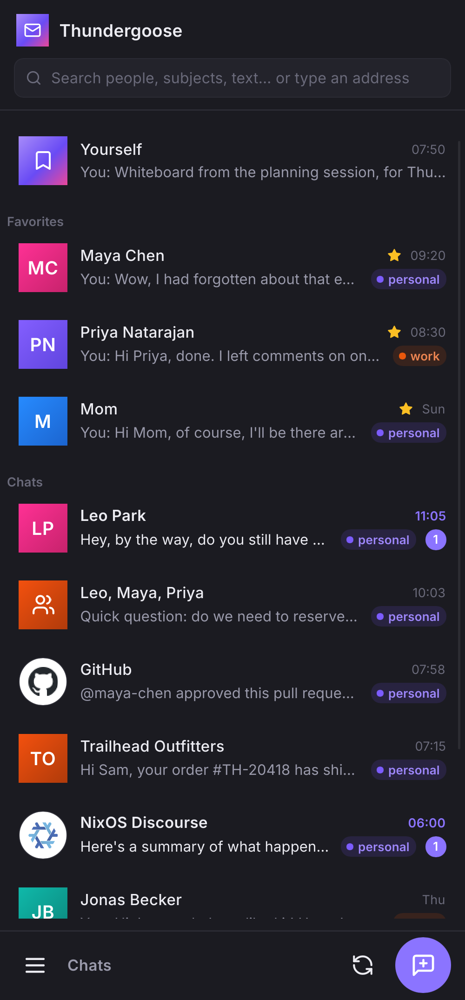
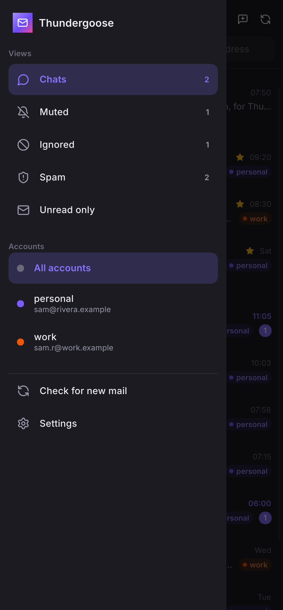
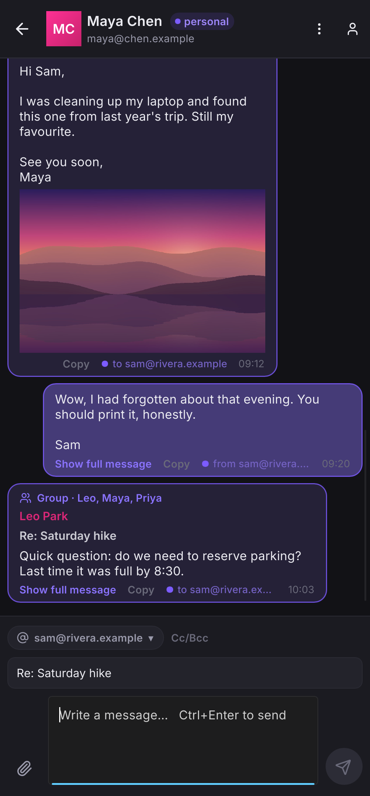
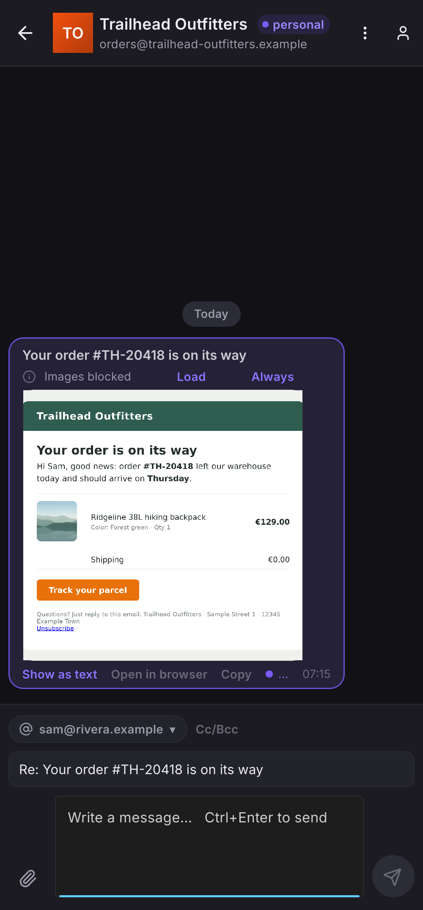
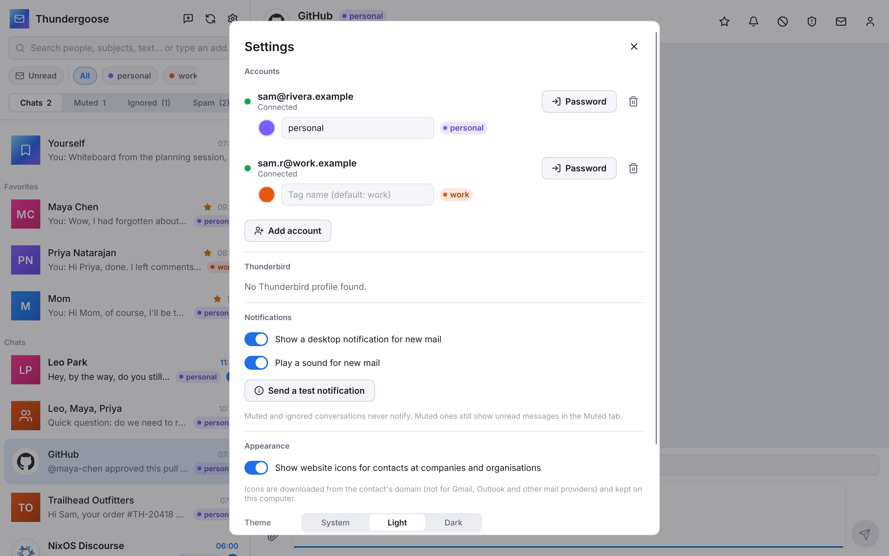

<div align="center">


# Thundergoose

### Email as conversations with people.

Your inbox, sent mail and folders, regrouped into chats: one per person or group, both directions,
across all your accounts.




<sub>All names and addresses in the screenshots are made up (<code>thundergoose --demo</code>).</sub>

</div>

---

Most mail clients show folders full of separate messages. Thundergoose shows **people**. Every
message belongs to a *peer*: the set of everyone on it except you. Pick a peer and you see your
whole history with them, as a chat:

| Peer | What you see |
| --- | --- |
| **Alice** | Every mail between you and Alice, whichever of your addresses it used. |
| **Alice, Bob** | The group conversation with exactly those two. It also shows up in Alice's and Bob's own chats, in bubbles with an accent border and a *Group · …* link. |
| **Yourself** | Notes and files you send between your own addresses. |

Thundergoose does one thing: email. No calendar, no feeds, no folders to manage.

## Highlights

<table>
<tr>
<td width="50%"></td>
<td width="50%"></td>
</tr>
<tr>
<td><b>Groups are chats too.</b> A thread with three people is its own conversation, and each
message also appears in every participant's personal chat.</td>
<td><b>Yourself.</b> A built-in chat for notes to self. Pick which of your addresses it comes
from and which one gets it; the bubbles show the way it went.</td>
</tr>
</table>

- **Which address, at a glance.** Every chat carries a colored tag for the address(es) of yours
  that contact writes to ("● work", "● gmail", in the colors of the account chips), and every
  message says *to* or *from* which of your addresses it went, its bubble tinted and outlined
  in that account's color. Name the tags and pick their
  colors (16 to choose from) in *Settings → Accounts*.
- **Unread filter.** The *Unread* chip narrows any tab (Chats, Muted, Ignored, Spam) to
  conversations with unread mail.
- **Favorites, Muted, Ignored, Spam, one click away.** Hover a chat in the list for ☆ / 🔔 / ⊘ /
  🛡 quick buttons, or use the chat header or the right-click menu. *Yourself* is pinned on top. Favorites are pinned on top; the rest
  is sorted by newest message. *Muted* chats move to their own tab and still count unread mail
  there, but never notify or play a sound. *Ignored* chats are silent and left out of every count. *Spam* collects what your servers'
  spam filters put in Junk (Junk folders are synced too, also on Gmail) plus chats you mark;
  *Not spam* brings a chat back for good. Marking only changes Thundergoose, not the server.
- **Website icons.** Contacts at companies and organisations get their site's icon, fetched once
  from their domain and cached. Addresses at Gmail, Outlook, GMX, Proton and about a hundred other
  mailbox providers keep their initials. Can be switched off in Settings.
- **HTML mail, rendered in the conversation.** Newsletters, receipts and anything with real
  layout are drawn inside the bubble by [Blitz](https://github.com/DioxusLabs/blitz), a Rust
  HTML/CSS engine: tables, buttons, embedded pictures. Quoted history is cut like in plain text.
  Text can be selected and copied (<kbd>Ctrl</kbd>+<kbd>C</kbd>). The old HTML attributes
  mail templates rely on (`cellpadding`, `align`, `valign`, `width`, `<font>` …) are translated
  to CSS the way browsers do. Links are clickable and show their real address on hover, which
  helps against phishing.
  Remote images (and the tracking pixels among them) stay blocked until you click *Load images*
  or *Always from this sender*. *Show as text* switches any mail to plain text.
- **Pictures inline.** Image attachments up to 10 MiB show right in the bubble (rotated the way
  the camera meant); click to open, hover to save. Everything else is a one-click attachment chip.
- **Your Thunderbird accounts, if you want them.** On first start Thundergoose offers to take
  over servers, passwords and OAuth sign-ins from your Thunderbird profile, or you set accounts
  up yourself ([details below](#your-thunderbird-accounts-without-setting-anything-up)).
- **Or add accounts in the app.** *Settings → Add account* finds the servers for an address:
  presets for Gmail/Outlook, the provider's autoconfig file, Thunderbird's ISP database, the
  domain's MX record (so Google Workspace and Microsoft 365 domains are recognized), and as a
  last resort probing the usual host names. Sign in with Google/Microsoft in the browser or with
  a password; both servers are tested before the account is added.
- **All accounts in one list.** A peer who wrote to two of your addresses is one conversation.
  Replies go out from the address the mail was sent to. Filter by account with the chips under
  the search box.
- **Chat-style bubbles.** Quoted history ("On … wrote:", "Am … schrieb", Outlook headers, `>`
  blocks) is cut from each reply, so a bubble shows only what is new. *Show full message* brings
  the quote back. *Open original* shows the HTML version in your browser with remote content
  blocked.
- **Reply like a chat.** Type and press <kbd>Ctrl</kbd>+<kbd>Enter</kbd>. Subject and threading
  headers are filled in; change the subject to start a new topic. The message shows up at once
  with a progress bar while it goes out, then "✓ Sent"; if the server refuses it, the bubble
  says why and offers *Retry* or *Edit*. The composer is free for the next message meanwhile.
- **Cc and Bcc.** *Cc/Bcc* in the composer. Cc'd people join the conversation (the mail files
  under that group, which also shows in everyone's own chat); Bcc'd people get a hidden copy.
- **Address suggestions.** To, Cc and Bcc suggest past contacts as you type, fuzzily ("mch"
  finds Maya Chen), most frequent and recent first. Contacts you ignored or marked as spam, and
  addresses only ever seen in Junk, are never suggested.
- **Search** across names, addresses, subjects and message text. Type an address you have no
  conversation with yet to start one.
- **Instant notifications.** Each account keeps an IMAP IDLE connection, so new mail shows up
  the moment the server has it, as a native notification (GNOME/KDE/… on Linux, Notification
  Center on macOS, toasts on Windows) with a short chime. Clicking it opens the conversation.
  *Settings → Send a test notification* or `thundergoose --notify-test` checks the setup.
- **Read state syncs both ways.** Opening a conversation marks it read on the server.
- **Newest first, cached.** Sync walks back in time: new mail first, then older headers in
  chunks, with the newest bodies downloaded in between, so recent mail is readable within
  seconds. A restart shows your mail immediately and only fetches what changed.

<table>
<tr>
<td width="50%"></td>
<td width="50%"></td>
</tr>
<tr>
<td><b>HTML mail.</b> Rendered in place, with embedded pictures; remote images only when you
allow them.</td>
<td><b>Spam tab.</b> Conversations whose mail sits only in a Junk folder land here, as do chats
you mark as spam. They never notify.</td>
</tr>
</table>

### On phones

<table>
<tr>
<td width="25%"></td>
<td width="25%"></td>
<td width="25%"></td>
<td width="25%"></td>
</tr>
</table>

On a phone (or any window narrower than 700 px) Thundergoose shows one thing at a time, like
Telegram: the list of people, or the conversation with one of them, with a back button. The
views (Chats, Muted, Ignored, Spam, Unread only), your accounts and Settings slide in from the
left, like in K-9 Mail. HTML mail is laid out at the phone's width, or zoomed out when it has a
fixed width.

<p align="center"></p>

## Install

Download the latest build from [Releases](https://github.com/WhiteBlackGoose/Thundergoose/releases):

| System | File | |
| --- | --- | --- |
| Ubuntu 22.04+, Debian 12+ | `…-ubuntu-amd64.deb` | `sudo apt install ./Thundergoose-*.deb` |
| Fedora | `…-fedora-x86_64.rpm` | `sudo dnf install ./Thundergoose-*.rpm` |
| Windows 10/11 | `…-windows-x64-setup.exe` | Installer (no admin rights needed); a portable `.exe` is attached too |
| macOS 11+ (Apple silicon and Intel) | `…-macos-universal.dmg` | Not notarized: the first time, right-click the app → *Open* |
| Android 8+ (64-bit ARM) | `…-android-arm64.apk` | Allow installing from your browser or file manager, then open the file |
| NixOS / Nix | | `nix run github:WhiteBlackGoose/Thundergoose` |

## Try it

```sh
nix develop
cargo run --release -- --demo     # made-up mail, no servers contacted
cargo run --release               # your accounts
```

Without Nix you need a Rust toolchain and the usual X11/Wayland/fontconfig development
libraries. `nix build` produces a wrapped binary with a desktop file and icon.

`thundergoose --screenshots docs` renders the pictures in this README from the demo data,
without a display.

**Android.** The app is the same library (`src/lib.rs`); `android/` only holds the entry point
and the APK settings. Build with the Android SDK and NDK installed (`ANDROID_HOME`,
`ANDROID_NDK_ROOT`): `cargo install cargo-apk`, then `cargo apk build --release` in `android/`. Not there yet on Android: attaching and saving files, opening
attachments, syncing while the app is closed, and the Thunderbird import (there is no
Thunderbird on the phone).

**Releases** are built by [`.github/workflows/release.yml`](.github/workflows/release.yml):
every push to `main` builds all packages as workflow artifacts, and pushing a tag `vX.Y.Z`
(after setting that version in `Cargo.toml`) publishes them as a GitHub release.

## Your Thunderbird accounts, without setting anything up

Nothing is read from Thunderbird until you ask. If a profile is found, the first start offers
*Import from Thunderbird* (also in *Settings* later), which takes over:

| What | How |
| --- | --- |
| IMAP/SMTP servers, ports, TLS/STARTTLS, user names, identities, display names | `prefs.js` |
| Saved passwords | `logins.json`, decrypted with the profile's `key4.db` |
| OAuth2 sign-ins (Gmail, Google Workspace, Microsoft 365 / Outlook) | Thunderbird's refresh tokens, used with Thunderbird's own OAuth client registration, so they stay valid |
| Contact names | Thunderbird address books and collected addresses |

After importing there's nothing to log in to. While *Stay linked* is on (Settings, on after an
import), contact names keep coming from Thunderbird's address books, and an expired token is
replaced by the newer one Thunderbird may have stored. Switch it off and Thundergoose never reads
the profile again. Either way, *Settings → Sign in* runs the same browser sign-in Thunderbird
uses (localhost redirect), and password accounts can get a new password there.
*Import from Thunderbird* can be run again at any time.

Profiles are found at `~/.thunderbird`, the Flatpak and Snap locations,
`~/Library/Thunderbird` (macOS) and `%APPDATA%\Thunderbird` (Windows). If you set a primary
password in Thunderbird, enter it next to *Import from Thunderbird* in Settings.

Run `thundergoose --check` to test the IMAP and SMTP login of every account without changing
anything, and `thundergoose --detect you@example.com` to see which servers would be used for an
address.

## Where data lives

| | |
| --- | --- |
| Linux | `~/.local/share/thundergoose/` |
| macOS | `~/Library/Application Support/Thundergoose/` |
| Windows | `%APPDATA%\Thundergoose\data\` |

`mail.sqlite` is the cache, `accounts.json` the account list, `settings.json` the appearance,
`favicons/` the website icons.
`secrets.json` (mode 0600) holds the passwords and refresh tokens, protected the same way
Thunderbird's are when no primary password is set. Set `THUNDERGOOSE_HOME` to use another
directory.

## Keyboard

| Keys | Action |
| --- | --- |
| <kbd>Ctrl</kbd>+<kbd>K</kbd> / <kbd>Ctrl</kbd>+<kbd>F</kbd> | Search |
| <kbd>Enter</kbd> in search | Open the first result |
| <kbd>Alt</kbd>+<kbd>↑</kbd> / <kbd>Alt</kbd>+<kbd>↓</kbd> | Previous / next conversation |
| <kbd>Ctrl</kbd>+<kbd>N</kbd> | New conversation |
| <kbd>Ctrl</kbd>+<kbd>+</kbd> / <kbd>Ctrl</kbd>+<kbd>−</kbd> / <kbd>Ctrl</kbd>+<kbd>0</kbd> | Larger / smaller / normal interface size (also in Settings → Appearance) |
| <kbd>Ctrl</kbd>+<kbd>Enter</kbd> | Send |
| <kbd>F5</kbd> / <kbd>Ctrl</kbd>+<kbd>R</kbd> | Check for new mail |
| <kbd>Esc</kbd> | Close dialog / cancel new conversation |

## Layout of the code

| File | |
| --- | --- |
| `src/tb.rs`, `src/nss.rs` | Thunderbird profile import; NSS `key4.db` / `logins.json` decryption |
| `src/oauth.rs`, `src/creds.rs` | OAuth2 refresh and browser sign-in; credentials for the network threads |
| `src/imapc.rs`, `src/sync.rs` | IMAP connections; one sync thread per account |
| `src/store.rs` | SQLite cache: mails (one per Message-ID), server locations, names |
| `src/parse.rs` | Envelopes, bodies, quote stripping, attachments |
| `src/html.rs` | Rendering HTML mail (Blitz), links, embedded and remote images |
| `src/send.rs` | SMTP sending (password or XOAUTH2) |
| `src/autoconfig.rs` | Finding servers for a new address |
| `src/notify.rs` | Desktop notifications and the chime |
| `src/favicon.rs` | Website icons and the list of mailbox providers |
| `src/demo.rs`, `src/shots.rs` | Demo data; headless screenshots |
| `src/app.rs` | UI glue |
| `ui/*.slint` | The interface (theme shared with [Neobrush](https://github.com/WhiteBlackGoose/Neobrush)) |

Fonts: Inter (OFL). Icons: Lucide (ISC).
